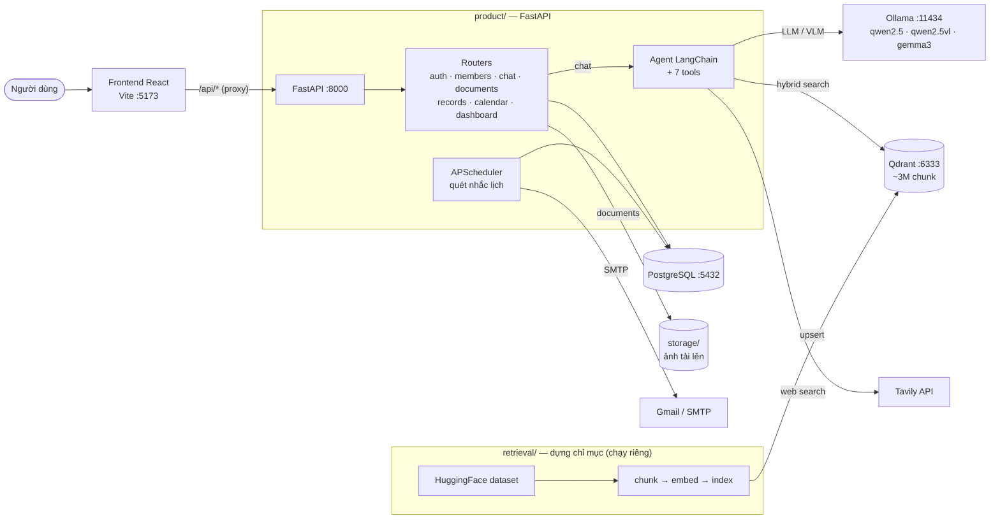
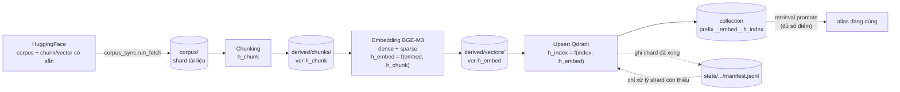
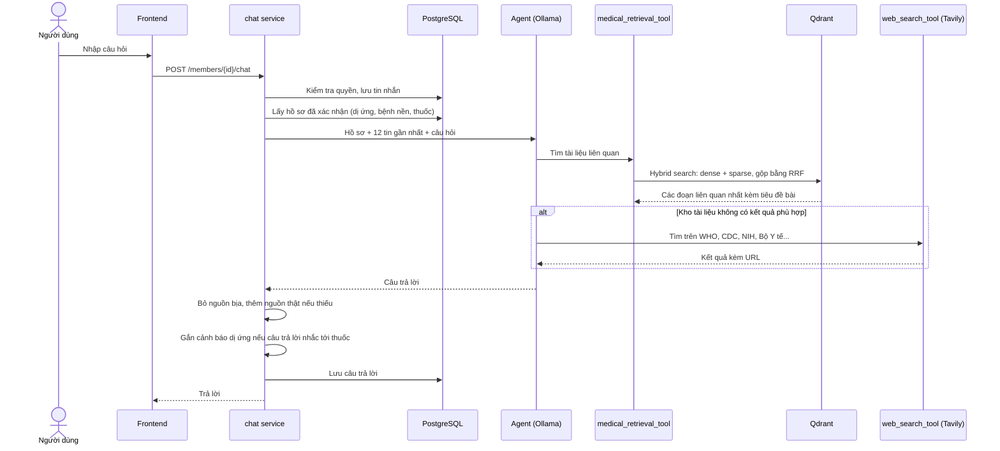
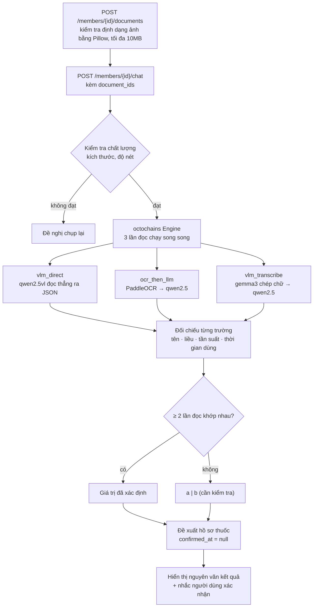
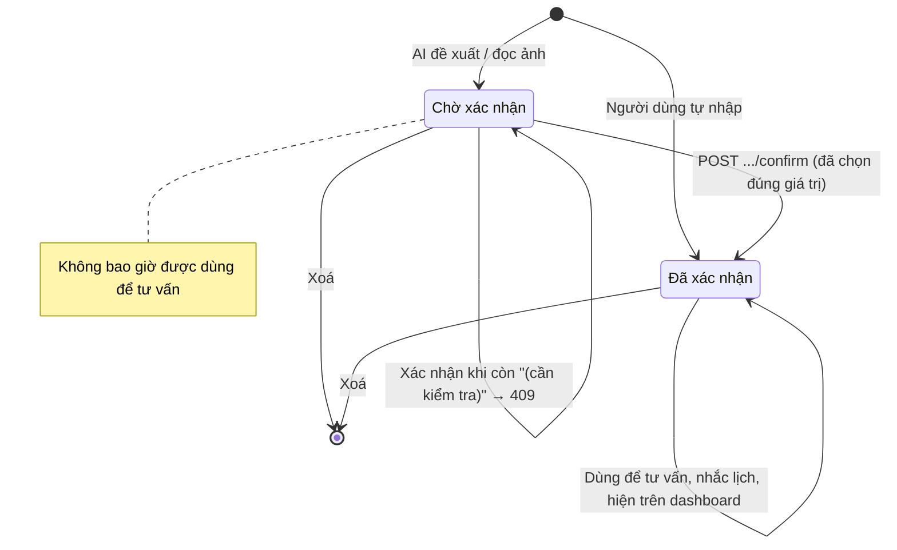
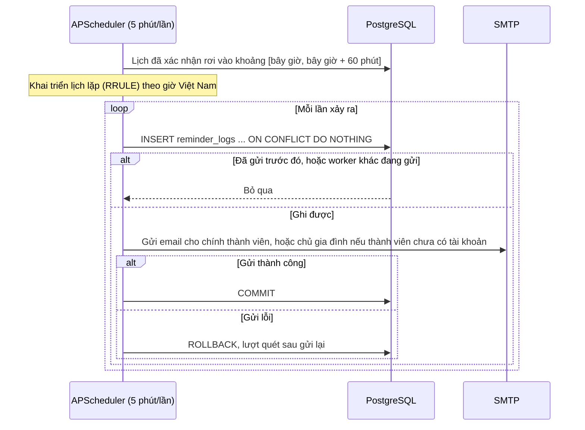
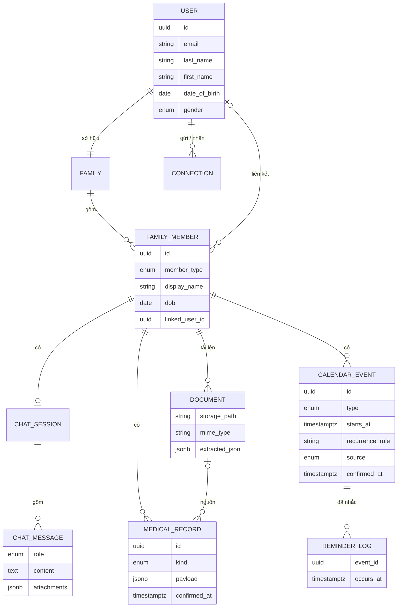
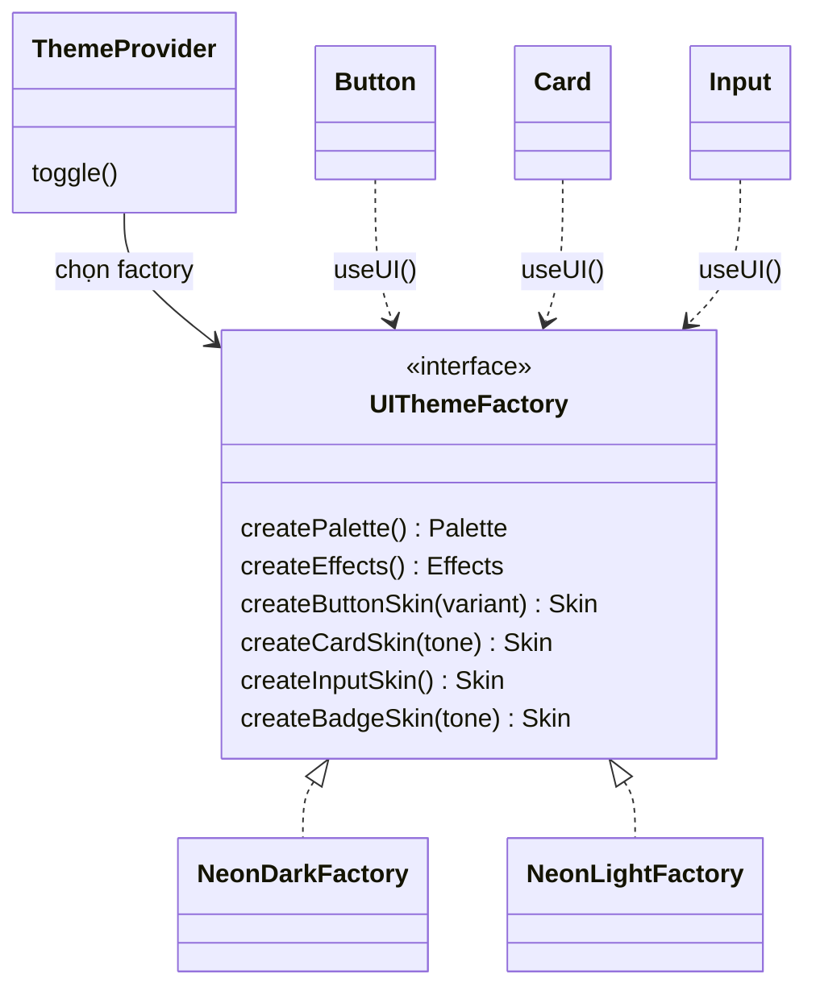

# AURELIA

<p align="center">
  <a href="https://www.python.org/"></a>
  <a href="https://fastapi.tiangolo.com/"></a>
  <a href="https://react.dev/"></a>
  <a href="https://qdrant.tech/"></a>
  <a href="https://ollama.com/"></a>
  <a href="LICENSE"></a>
</p>

<p align="center">
  
</p>

<p align="center">
  <b>A</b>ssisted <b>U</b>nderstanding &amp; <b>R</b>easoning for <b>E</b>vidence-based <b>L</b>ife &amp; <b>I</b>ntegrated <b>A</b>ssistance
</p>

**AURELIA** là trợ lý sức khoẻ gia đình. AURELIA trả lời câu hỏi y khoa bằng cách tra cứu kho tài liệu y tế đa ngôn ngữ
(tiếng Việt, tiếng Trung). Kho được tìm kiếm bằng hybrid search (dense + sparse) trên Qdrant. Hệ thống quản lý
hồ sơ và lịch khám cho từng thành viên trong gia đình, đọc ảnh đơn thuốc, và gửi email nhắc lịch.

**Chức năng chính**

- **Chat với AURELIA**: câu trả lời có dẫn nguồn từ kho tài liệu. Kho không có thì tìm trên các trang y tế uy tín.
- **Đọc ảnh đơn thuốc**: 3 agent đọc ảnh **chạy song song** bằng [octochains](https://pypi.org/project/octochains/),
  mỗi agent dùng một model khác nhau, rồi đối chiếu từng trường. Trường nào các lần đọc không khớp sẽ được
  đánh dấu để người dùng tự chọn.
- **Hồ sơ và lịch theo mô hình đề xuất → xác nhận**: AI chỉ tạo đề xuất. Dữ liệu chỉ có hiệu lực, và chỉ được
  dùng để tư vấn, sau khi người dùng xác nhận.
- **Nhắc lịch khám và uống thuốc qua email**, hỗ trợ lịch lặp theo chuẩn RRULE.
- **Phân quyền theo gia đình**: chủ gia đình quản lý thành viên chưa có tài khoản (con nhỏ, ông bà...). Thành
  viên đã liên kết tài khoản thì tự quản lý hồ sơ của mình.

### Các model sử dụng

Mọi model đều chạy local, không gửi dữ liệu sức khoẻ ra dịch vụ AI bên ngoài.

| Model | Chạy bằng | Vai trò |
|---|---|---|
| `qwen2.5:7b-instruct` | Ollama | Model chat chính của AURELIA: gọi tool, soạn câu trả lời. Đồng thời chuyển văn bản thô thành JSON cho agent 2 và 3 |
| `qwen2.5vl:7b` | Ollama | **Agent 1** `vlm_direct`: nhìn ảnh, đọc thẳng ra JSON đơn thuốc |
| PaddleOCR (PP-OCRv6) | Python | **Agent 2** `ocr_then_llm`: nhận dạng chữ, sau đó qwen2.5 cấu trúc lại |
| `gemma3:4b` | Ollama | **Agent 3** `vlm_transcribe`: chép nguyên văn chữ trong ảnh, sau đó qwen2.5 cấu trúc lại |
| BGE-M3 | FlagEmbedding | Mã hoá câu hỏi và tài liệu thành vector dense + sparse cho hybrid search |

Agent 1 dùng Qwen, còn agent 3 dùng Gemma: hai model thuộc hai họ khác nhau nên nếu đọc sai thì thường sai theo
những kiểu khác nhau. Nhờ vậy, một tên thuốc đọc nhầm không thể được "xác nhận" chỉ vì hai lần đọc cùng nhầm
giống nhau. Agent 3 đổi model qua biến `PRODUCT_VLM_TRANSCRIBE_MODEL`.

---

## Kiến trúc

### Tổng quan hệ thống



### Pipeline dựng chỉ mục (`retrieval/` + `corpus_sync/`)

Mỗi bước tạo ra một mã hash, và mã này được tính nối tiếp từ hash của bước trước. Vì vậy chỉ cần sửa cấu hình ở
bất kỳ bước nào là tự sinh ra thư mục mới và collection Qdrant mới. Dữ liệu cũ không bao giờ bị ghi đè.



### Luồng hỏi đáp



`member_id` được truyền cho tool qua cấu hình của lượt chạy, không bao giờ lấy từ tham số do LLM tạo ra. Vì vậy
không thể dùng prompt để đọc dữ liệu của thành viên khác.

### Đọc ảnh đơn thuốc



### Đề xuất → xác nhận



### Nhắc lịch qua email



### Mô hình dữ liệu



### Theme frontend (Abstract Factory)



Factory trả về **skin** (một bộ biến CSS) chứ không trả về component. Nhờ vậy, khi đổi theme React không phải
dựng lại cây giao diện, và chữ đang gõ trong ô nhập không bị mất.

---

## Cấu trúc thư mục

```text
.
├─ product/                  # Backend FastAPI
│  ├─ apps/api/              #   auth, members, chat, documents, records, calendar, dashboard
│  ├─ apps/agent/            #   Agent LangChain, prompt, tools (retrieval, web, hồ sơ, lịch, đọc ảnh)
│  ├─ db/models/             #   SQLAlchemy models
│  └─ db/migrations/         #   Alembic
├─ frontend/                 # React 18 + TypeScript + Vite
├─ retrieval/                # Chunk, embed, index, search, rerank
├─ corpus_sync/              # Tải corpus và dữ liệu đã tính sẵn từ HuggingFace
├─ common/                   # Cấu hình, schema dùng chung
├─ configs/                  # YAML cấu hình pipeline
└─ docker-compose.yml        # Qdrant + PostgreSQL
```

## Cài đặt và chạy

**Yêu cầu:** Python 3.12, Node.js ≥ 16, Docker, [Ollama](https://ollama.com).

```powershell
# 1. Qdrant + PostgreSQL
docker-compose up -d

# 2. Các model chạy local
ollama pull qwen2.5:7b-instruct
ollama pull qwen2.5vl:7b
ollama pull gemma3:4b

# 3. Backend
python -m venv venv
.\venv\Scripts\pip install -r requirements.txt
copy .env.example .env               # rồi điền key (xem bảng bên dưới)
.\venv\Scripts\alembic upgrade head
.\venv\Scripts\uvicorn product.apps.api.main:app --reload     # http://127.0.0.1:8000/docs

# 4. Frontend
cd frontend
npm install
npm run dev                          # http://127.0.0.1:5173
```

**Dựng chỉ mục Qdrant**: chỉ cần làm lần đầu. Bước embedding nên chạy trên máy có GPU.

```powershell
python -m corpus_sync.run_fetch           # tải corpus và chunk/vector đã tính sẵn
python -m retrieval.run_index             # chunk → embed → index, chỉ xử lý phần còn thiếu
python -m retrieval.promote --min-points 1
```

## Biến môi trường chính (`.env`)

| Biến | Ý nghĩa |
|---|---|
| `PRODUCT_DATABASE_URL` | Kết nối PostgreSQL (asyncpg) |
| `PRODUCT_JWT_SECRET` | Khoá ký JWT, dùng chuỗi ngẫu nhiên dài |
| `PRODUCT_LLM_MODEL` / `PRODUCT_VLM_MODEL` | Model chat / model đọc ảnh trên Ollama |
| `PRODUCT_VLM_TRANSCRIBE_MODEL` | Model đọc ảnh thứ hai, khác họ với model trên để hai lần đọc không sai giống nhau |
| `PRODUCT_TAVILY_API_KEY` | Bật tìm kiếm web |
| `PRODUCT_SMTP_HOST` / `_PORT` / `_USER` / `_PASSWORD` / `_FROM` | Gửi email nhắc lịch. Để trống host thì tắt chức năng nhắc |
| `PRODUCT_REMINDER_LEAD_MINUTES` | Nhắc trước bao nhiêu phút (mặc định 60) |
| `QDRANT_URL` | Địa chỉ Qdrant |

Danh sách đầy đủ có trong [`.env.example`](.env.example).

## API

Mọi endpoint (trừ `/auth/register` và `/auth/login`) cần header `Authorization: Bearer <token>`. Với các
endpoint dạng `/members/{member_id}/...`, nếu không có quyền thì trả **404** (không phải 403), để người ngoài
không dò ra được `member_id` nào tồn tại. Tài liệu tương tác: `http://127.0.0.1:8000/docs`.

| Nhóm | Endpoint |
|---|---|
| Xác thực | `POST /auth/register` · `POST /auth/login` · `GET /auth/me` |
| Gia đình | `GET /families/me` · `GET`/`POST /families/me/members` · `POST /connections` · `POST /connections/{id}/respond` |
| Tổng quan | `GET /dashboard` |
| Chat | `GET`/`POST /members/{id}/chat` (body có thể kèm `document_ids`) |
| Tài liệu | `GET`/`POST /members/{id}/documents` |
| Hồ sơ | `GET /members/{id}/records?status_filter=` · `POST .../records` · `POST .../records/{rid}/confirm` · `DELETE .../records/{rid}` |
| Lịch | `GET /members/{id}/calendar?start=&end=&include_pending=` · `GET .../calendar/pending` · `POST .../calendar` · `POST .../calendar/{eid}/confirm` · `DELETE .../calendar/{eid}` |
