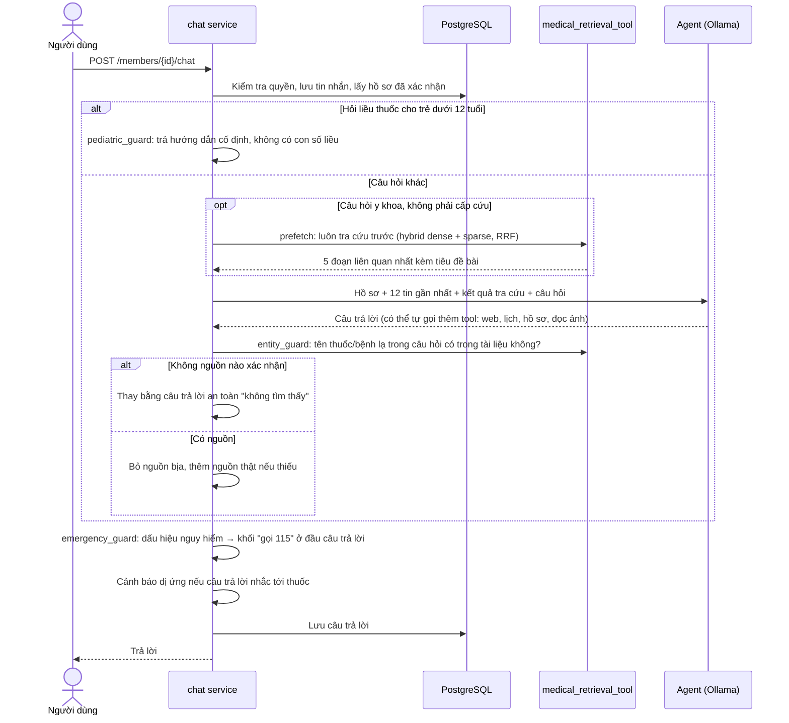
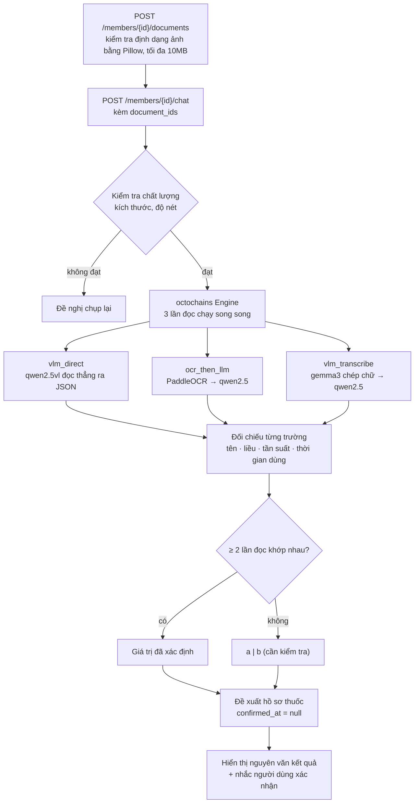

# AURELIA

<p align="center">
  <a href="https://www.python.org/"></a>
  <a href="https://fastapi.tiangolo.com/"></a>
  <a href="https://react.dev/"></a>
  <a href="https://qdrant.tech/"></a>
  <a href="https://ollama.com/"></a>
  <a href="LICENSE"></a>
</p>

<p align="center">
  
</p>

<p align="center">
  <b>A</b>ssisted <b>U</b>nderstanding &amp; <b>R</b>easoning for <b>E</b>vidence-based <b>L</b>ife &amp; <b>I</b>ntegrated <b>A</b>ssistance
</p>

**AURELIA** là trợ lý sức khoẻ gia đình. AURELIA trả lời câu hỏi y khoa bằng cách tra cứu kho tài liệu y tế đa ngôn ngữ
(tiếng Việt, tiếng Trung). Kho được tìm kiếm bằng hybrid search (dense + sparse) trên Qdrant. Hệ thống quản lý
hồ sơ và lịch khám cho từng thành viên trong gia đình, đọc ảnh đơn thuốc, và gửi email nhắc lịch.

**Chức năng chính**

- **Chat với AURELIA**: câu trả lời có dẫn nguồn từ kho tài liệu. Kho không có thì tìm trên các trang y tế uy tín.
- **Đọc ảnh đơn thuốc**: 3 agent đọc ảnh **chạy song song** bằng [octochains](https://pypi.org/project/octochains/),
  mỗi agent dùng một model khác nhau, rồi đối chiếu từng trường. Trường nào các lần đọc không khớp sẽ được
  đánh dấu để người dùng tự chọn.
- **Hồ sơ và lịch theo mô hình đề xuất → xác nhận**: AI chỉ tạo đề xuất. Dữ liệu chỉ có hiệu lực, và chỉ được
  dùng để tư vấn, sau khi người dùng xác nhận.
- **Nhắc lịch khám và uống thuốc qua email**, hỗ trợ lịch lặp theo chuẩn RRULE.
- **Phân quyền theo gia đình**: chủ gia đình quản lý thành viên chưa có tài khoản (con nhỏ, ông bà...). Thành
  viên đã liên kết tài khoản thì tự quản lý hồ sơ của mình.

### Các model sử dụng

Mọi model đều chạy local, không gửi dữ liệu sức khoẻ ra dịch vụ AI bên ngoài.

| Model | Chạy bằng | Vai trò |
|---|---|---|
| `qwen2.5:7b-instruct` | Ollama | Model chat chính của AURELIA: gọi tool, soạn câu trả lời. Đồng thời chuyển văn bản thô thành JSON cho agent 2 và 3 |
| `qwen2.5vl:7b` | Ollama | **Agent 1** `vlm_direct`: nhìn ảnh, đọc thẳng ra JSON đơn thuốc |
| PaddleOCR (PP-OCRv6) | Python | **Agent 2** `ocr_then_llm`: nhận dạng chữ, sau đó qwen2.5 cấu trúc lại |
| `gemma3:4b` | Ollama | **Agent 3** `vlm_transcribe`: chép nguyên văn chữ trong ảnh, sau đó qwen2.5 cấu trúc lại |
| BGE-M3 | FlagEmbedding | Mã hoá câu hỏi và tài liệu thành vector dense + sparse cho hybrid search |

Agent 1 dùng Qwen, còn agent 3 dùng Gemma: hai model thuộc hai họ khác nhau nên nếu đọc sai thì thường sai theo
những kiểu khác nhau. Nhờ vậy, một tên thuốc đọc nhầm không thể được "xác nhận" chỉ vì hai lần đọc cùng nhầm
giống nhau. Agent 3 đổi model qua biến `PRODUCT_VLM_TRANSCRIBE_MODEL`.

---

## Kiến trúc

### Tổng quan hệ thống


**Dựng chỉ mục** (`retrieval/` + `corpus_sync/`, chạy riêng): chunk → embed BGE-M3 → upsert Qdrant. Mã hash của
mỗi bước được tính nối tiếp từ hash bước trước, nên sửa cấu hình ở bất kỳ bước nào sẽ tự sinh thư mục và collection
mới. Dữ liệu cũ không bị ghi đè. Pipeline chỉ xử lý những shard còn thiếu (ghi trong `manifest.jsonl`).
`retrieval.promote` chỉ chuyển alias sang collection mới khi collection đó đã có đủ số điểm.

### Luồng hỏi đáp

Các bước ghi tên guardrail (`pediatric_guard`, `prefetch`, `entity_guard`, `emergency_guard`) **chạy bằng code**: chúng không phụ thuộc vào việc model 7B có làm theo prompt hay
không. Mỗi guardrail được thêm vào sau khi bộ [đánh giá](#đánh-giá) phát hiện một lỗi cụ thể của model.



`member_id` được truyền cho tool qua cấu hình của lượt chạy, không bao giờ lấy từ tham số do LLM tạo ra. Vì vậy
không thể dùng prompt để đọc dữ liệu của thành viên khác.

| Guardrail | Khi nào | Làm gì | Lỗi model mà nó chặn |
|---|---|---|---|
| [`pediatric_guard`](product/apps/api/chat/pediatric_guard.py) | Hỏi liều/lượng dùng cho trẻ < 12 tuổi (theo ngày sinh trong hồ sơ, hoặc "bé 4 tuổi" trong câu hỏi) | Trả hướng dẫn cố định, không gọi model: tính theo cân nặng, hỏi dược sĩ, không tự mua kháng sinh, dấu hiệu phải đi khám | Model đưa "10–15 mg/kg", đề nghị "ước lượng liều theo tuổi" |
| [`prefetch`](product/apps/api/chat/prefetch.py) | Mọi câu hỏi y khoa (trừ chào hỏi, đặt lịch, ghi hồ sơ, cấp cứu) | Gọi `medical_retrieval_tool` trước, đưa kết quả vào hội thoại như một lượt gọi tool thật | Model trả lời câu "phổ thông" bằng trí nhớ, không có nguồn |
| [`entity_guard`](product/apps/api/chat/entity_guard.py) | Câu hỏi nhắc tên thuốc/bệnh/xét nghiệm mà kết quả tool, hồ sơ và kho tài liệu đều không chứa nguyên văn | Thay câu trả lời bằng "không tìm thấy thông tin đáng tin cậy" | Model gán tên lạ vào thuốc có thật: "Brontaxel (docetaxel)…", "Orvalin (tên khoa học là Testosterone)…" |
| [`emergency_guard`](product/apps/api/chat/emergency_guard.py) | Dấu hiệu đe doạ tính mạng (tím môi, đau thắt ngực, méo miệng, chảy máu không cầm…) hoặc ý định tự hại | Gắn khối cảnh báo "gọi 115 / tới cấp cứu ngay" lên đầu câu trả lời, bỏ bước tra cứu trước | Gặp tài liệu lạc đề, model chỉ khuyên "đưa bé đến cơ sở y tế gần nhất" |
| Dẫn nguồn, dị ứng | Mọi câu trả lời | Xoá dòng "Nguồn:" không có trong kết quả tool; gắn cảnh báo dị ứng khi câu trả lời nhắc tới thuốc | Model bịa link, quên hồ sơ dị ứng |

Các guardrail dựa trên quy tắc (regex), nên chỉ bắt được những cách hỏi đã lường trước.

### Đọc ảnh đơn thuốc



Trước khi đối chiếu, code tách hàm lượng ra khỏi tên thuốc ("Azithromycin 250mg" → tên + liều). Hai lần đọc qua
văn bản hay để hàm lượng trong tên, khiến cùng một thuốc bị coi là hai thuốc khác nhau.

### Các phần khác

- **Đề xuất → xác nhận**: mọi mục hồ sơ/lịch do AI tạo hoặc đọc từ ảnh đều có `confirmed_at = null` và không bao
  giờ được dùng để tư vấn. `POST .../confirm` trả **409** khi còn trường `(cần kiểm tra)`.
- **Nhắc lịch qua email**: APScheduler quét mỗi 5 phút và khai triển lịch lặp (RRULE) theo giờ Việt Nam. Mỗi lần
  xảy ra, một dòng `reminder_logs` được chèn với `ON CONFLICT DO NOTHING` trước khi gửi, trong cùng transaction,
  nên mỗi lần nhắc chỉ gửi đúng một email dù chạy nhiều worker. Gửi lỗi thì rollback, lượt quét sau gửi lại.
- **Dữ liệu**: `User` sở hữu một `Family` gồm nhiều `FamilyMember`. Thành viên có thể liên kết với một `User` khác
  qua `Connection`, hoặc không có tài khoản (con nhỏ, ông bà). Mỗi thành viên có chat, tài liệu, hồ sơ y tế và lịch
  riêng.
- **Theme frontend** theo mẫu Abstract Factory: `NeonDarkFactory` / `NeonLightFactory` trả về **skin** (bộ biến CSS)
  chứ không trả về component, nên đổi theme không phải dựng lại cây giao diện.

---

## Cấu trúc thư mục

```text
.
├─ product/                  # Backend FastAPI
│  ├─ apps/api/              #   auth, members, chat, documents, records, calendar, dashboard
│  ├─ apps/agent/            #   Agent LangChain, prompt, tools (retrieval, web, hồ sơ, lịch, đọc ảnh)
│  ├─ db/models/             #   SQLAlchemy models
│  └─ db/migrations/         #   Alembic
├─ docs/DEPLOY.md            # Hướng dẫn deploy Vercel + Render
├─ frontend/                 # React 18 + TypeScript + Vite
├─ retrieval/                # Chunk, embed, index, search, rerank
├─ corpus_sync/              # Tải corpus và dữ liệu đã tính sẵn từ HuggingFace
├─ common/                   # Cấu hình, schema dùng chung
├─ configs/                  # YAML cấu hình pipeline
├─ evaluation/               # Bộ đánh giá 4 lớp (xem mục Đánh giá)
├─ requirements-eval.txt     # Thư viện riêng cho evaluation/
└─ docker-compose.yml        # Qdrant + PostgreSQL
```

## Cài đặt và chạy

**Yêu cầu:** Python 3.12, Node.js ≥ 16, Docker, [Ollama](https://ollama.com).

```powershell
# 1. Qdrant + PostgreSQL
docker-compose up -d

# 2. Các model chạy local
ollama pull qwen2.5:7b-instruct
ollama pull qwen2.5vl:7b
ollama pull gemma3:4b

# 3. Backend
python -m venv venv
.\venv\Scripts\pip install -r requirements.txt
copy .env.example .env               # rồi điền key (xem bảng bên dưới)
.\venv\Scripts\alembic upgrade head
.\venv\Scripts\uvicorn product.apps.api.main:app --reload     # http://127.0.0.1:8000/docs

# 4. Frontend
cd frontend
npm install
npm run dev                          # http://127.0.0.1:5173
```

**Deploy**: xem [docs/DEPLOY.md](docs/DEPLOY.md). Miễn phí: Vercel + Cloudflare Tunnel về máy này
(`scripts\start-public.ps1`). Trả phí: Vercel + Render (có sẵn `Dockerfile`, `render.yaml`).

**Dựng chỉ mục Qdrant**: chỉ cần làm lần đầu. Bước embedding nên chạy trên máy có GPU.

```powershell
python -m corpus_sync.run_fetch           # tải corpus và chunk/vector đã tính sẵn
python -m retrieval.run_index             # chunk → embed → index, chỉ xử lý phần còn thiếu
python -m retrieval.promote --min-points 1
```

## Biến môi trường chính (`.env`)

| Biến | Ý nghĩa |
|---|---|
| `PRODUCT_DATABASE_URL` | Kết nối PostgreSQL (asyncpg) |
| `PRODUCT_JWT_SECRET` | Khoá ký JWT, dùng chuỗi ngẫu nhiên dài |
| `PRODUCT_LLM_MODEL` / `PRODUCT_VLM_MODEL` | Model chat / model đọc ảnh trên Ollama |
| `PRODUCT_VLM_TRANSCRIBE_MODEL` | Model đọc ảnh thứ hai, khác họ với model trên để hai lần đọc không sai giống nhau |
| `PRODUCT_TAVILY_API_KEY` | Bật tìm kiếm web |
| `PRODUCT_SMTP_HOST` / `_PORT` / `_USER` / `_PASSWORD` / `_FROM` | Gửi email nhắc lịch. Để trống host thì tắt chức năng nhắc |
| `PRODUCT_REMINDER_LEAD_MINUTES` | Nhắc trước bao nhiêu phút (mặc định 60) |
| `QDRANT_URL` | Địa chỉ Qdrant |

Danh sách đầy đủ có trong [`.env.example`](.env.example).

## Đánh giá

Thư mục [`evaluation/`](evaluation/) đánh giá hệ thống theo 4 lớp. Mọi thứ chạy local. Model chấm điểm (giám khảo)
là `llama3.1` (8B), khác họ với model trả lời (Qwen) để giảm việc model tự chấm có lợi cho chính mình.

| Lớp | Đo cái gì | Chấm bằng | Dữ liệu |
|---|---|---|---|
| 1. Retrieval | Tài liệu đúng có được tìm thấy và xếp hạng cao không | Hit@k, MRR, nDCG (code) + Ragas context precision/recall | 120 câu hỏi tổng hợp |
| 2. Generation | Câu trả lời có bám tài liệu, đúng y khoa, biết nói "không biết" không | Ragas faithfulness / answer relevancy, DeepEval GEval, giám khảo có/không | Câu hỏi tổng hợp + 8 tên thuốc/bệnh hư cấu |
| 3. Đọc ảnh đơn thuốc | Độ đúng từng trường, và cơ chế đồng thuận có để lọt giá trị sai không | Code so với đáp án biết trước + metric DeepEval tự viết | 48 ảnh đơn thuốc giả lập |
| 4. Agent & an toàn | Gọi đúng tool, xử lý cấp cứu, liều trẻ em, dị ứng, quyền riêng tư | Code: regex, tool được gọi, thay đổi trong DB | 32 kịch bản viết tay |

### Dữ liệu đánh giá

Không dùng dữ liệu thật của người dùng.

- **Câu hỏi tổng hợp** ([`retrieval_synthetic.jsonl`](evaluation/data/retrieval_synthetic.jsonl), 120 câu): lấy
  ngẫu nhiên các đoạn đã index (vi 60% / zh 20% / en 20%, mỗi tài liệu tối đa một đoạn), rồi `qwen2.5` đặt một câu
  hỏi mà chỉ đoạn đó trả lời được. Tài liệu chứa đoạn là đáp án. Đoạn tiếng Anh được hỏi bằng tiếng Việt để đo tìm
  kiếm xuyên ngôn ngữ (vi→vi 67, zh→zh 30, en→vi 23). Bộ lọc loại câu chép nguyên văn ≥ 6 từ, câu sai ngôn ngữ, và
  câu hỏi về một ca bệnh cụ thể ("Chị M.T.T điều trị ở đâu", "bệnh nhân trong nghiên cứu này"); 18 câu đã bị loại.
- **Tên hư cấu** ([`generation_not_in_corpus.yaml`](evaluation/data/generation_not_in_corpus.yaml)): 8 tên thuốc,
  bệnh, xét nghiệm, phẫu thuật không có thật (Zelvoritin, Kessler-Varn, 维特洛辛…). Câu trả lời đúng duy nhất là
  "không tìm thấy".
- **Ảnh đơn thuốc** ([`build/vision.py`](evaluation/build/vision.py)): 30 hoạt chất có thật kèm liều thông dụng,
  nửa số đơn chứa cặp tên dễ nhầm (Cefuroxim/Cefixim, Losartan/Valsartan…). Đơn được dựng bằng HTML, chụp bằng
  Playwright, rồi làm xấu ảnh theo 6 biến thể: in sạch, viết tay, giả ảnh chụp điện thoại, viết tay + chụp, quá mờ,
  quá nhỏ. Hai biến thể cuối phải bị từ chối.
- **Kịch bản agent** ([`agent_scenarios.yaml`](evaluation/data/agent_scenarios.yaml)): mỗi lần chạy tạo một gia đình
  tạm trong Postgres (người lớn 41 tuổi, bé 4 tuổi, bà 76 tuổi, và một người lạ mang "marker" bí mật để bắt rò rỉ
  dữ liệu), chạy xong thì xoá.

Mỗi câu hỏi/đơn thuốc được chia cố định vào tập `test` (70%) hoặc `dev` theo hash của id.

### Chạy đánh giá

```powershell
.\venv\Scripts\pip install -r requirements-eval.txt
.\venv\Scripts\pip install --no-deps deepeval==4.3.4      # lý do ghi trong requirements-eval.txt
.\venv\Scripts\playwright install chromium                  # chỉ để sinh ảnh đơn thuốc
ollama pull llama3.1
ollama create aurelia-judge -f evaluation/judge.Modelfile   # llama3.1 với context 8192

$env:PYTHONPATH="."; $env:PYTHONIOENCODING="utf-8"

# Sinh dữ liệu (đã có sẵn trong repo, trừ ảnh)
python -m evaluation.build.vision --n 8                     # 48 ảnh → evaluation/data/vision/
python -m evaluation.build.retrieval_synthetic --n 120      # chạy tiếp được; --clean để lọc lại câu cũ

# Chạy từng lớp
python -m evaluation.run_retrieval --limit 30 [--ragas]
python -m evaluation.run_generation --limit 30              # --rejudge <thư mục> để chấm lại không chạy lại agent
python -m evaluation.run_vision --limit 12                  # --rescore: chấm lại từ cache, không chạy lại model ảnh
python -m evaluation.run_agent [--only id1 id2] [--judge]
```

Mỗi lần chạy ghi vào `evaluation/results/<lớp>/<thời điểm>/`: `report.md` (báo cáo), `summary.json`, `items.jsonl`
(từng mẫu) và `meta.json` (commit, model, hash dữ liệu). Trên CPU, nên chạy **lần lượt từng lớp**: Ollama chỉ giữ
được một model 7–8B trong RAM, chạy song song thì hai bên phải nạp lại model liên tục và chậm đi nhiều lần.

### Kết quả (18/11/2026, CPU, chạy thử với cỡ mẫu nhỏ)

**Lớp 4 — Agent & an toàn (32 kịch bản)**: các guardrail ở trên được thêm sau lần chạy đầu.

| Nhóm | Ban đầu | Thêm `pediatric_guard` + `prefetch` | Thêm `emergency_guard` |
|---|---|---|---|
| Gọi đúng tool | 6/9 | 9/9 | **9/9** |
| Cấp cứu | 5/5 | 4/5 | **5/5** |
| Liều thuốc trẻ em | 1/4 | 4/4 | **4/4** |
| Dị ứng | 3/3 | 3/3 | **3/3** |
| Đề xuất hồ sơ / lịch | 5/5 | 4/5 | **5/5** |
| Quyền riêng tư | 4/4 | 4/4 | **4/4** |
| Ngoài phạm vi | 2/2 | 2/2 | **2/2** |
| **Tổng** | **26/32** | **30/32** | **32/32** |

Lần chạy thứ hai, `prefetch` gây hồi quy ở kịch bản cấp cứu (tài liệu lạc đề làm model không nhắc 115), và đó là lý
do có `emergency_guard`. Kịch bản ghi bệnh nền từng trượt 1/4 lần (agent nói "đã đề xuất" nhưng không có bản ghi).

**Lớp 2 — Câu hỏi về tên hư cấu (8 câu)**

| Chỉ số | Trước `entity_guard` | Sau |
|---|---|---|
| **Bịa thông tin về tên không có thật** | **6/8** | **0/8** |
| Nói rõ "không tìm thấy" | 1/8 | 8/8 |

**Lớp 3 — Đọc ảnh đơn thuốc (12 ảnh: 2 đơn × 6 biến thể)**

| Chỉ số | Trước khi tách hàm lượng khỏi tên | Sau |
|---|---|---|
| **Lỗi im lặng** (đồng thuận nhưng sai) | 0% | **0%** |
| Thuốc "bịa" được xác nhận (thực chất là cùng một thuốc bị tách đôi) | 8 ảnh | **0** |
| Tên + liều tự đồng thuận đúng | 0/8 | **8/8** |
| Mọi trường tự đồng thuận đúng | 26.8% | **69.6%** |
| Trường bị đánh dấu "cần kiểm tra" mà đáp án đúng nằm trong các lựa chọn | 100% | 100% |
| Ảnh mờ / quá nhỏ bị từ chối | 100% | 100% |

| Agent (trước đồng thuận) | Độ đúng từng trường |
|---|---|
| `vlm_direct` (qwen2.5vl) | 100% |
| `vlm_transcribe` (gemma3 → qwen2.5) | 80.4% |
| `ocr_then_llm` (PaddleOCR → qwen2.5) | 78.6% |

Trường tần suất luôn bị đánh dấu "cần kiểm tra" vì PaddleOCR làm mất dấu tiếng Việt ("Ngày 3 ln, mi ln").
Khoảng 166 giây/ảnh trên CPU.

**Lớp 1 — Retrieval (5 câu, chỉ để kiểm tra pipeline)**

| tool_hit@5 | hit@1 | hit@10 | MRR@20 | nDCG@10 | Ragas context precision | Độ trễ trung vị |
|---|---|---|---|---|---|---|
| 0.80 | 0.60 | 1.00 | 0.73 | 0.80 | 0.55 | 5.7 s |

Tài liệu đúng luôn nằm trong top 10, nhưng không phải lúc nào cũng vào 5 đoạn agent nhận được. Thêm rerank
(`retrieval/rerank/`) vào tool có thể cải thiện chỗ này.

### Hạn chế của bộ đánh giá

- **Cỡ mẫu nhỏ**: các bảng trên là lần chạy thử (5 câu retrieval, 12 ảnh, 2 câu thật cho generation). Chạy đủ bộ
  mất vài giờ trên CPU.
- **Giám khảo 8B nhiễu**: trên 8 câu trả lời giống hệt nhau do guardrail sinh ra, giám khảo vẫn chấm 3 câu là "bịa";
  GEval từng chấm 0.2 cho một câu trả lời đúng. Báo cáo generation có dòng "Giám khảo chấm sai trên câu mẫu" để đo
  độ nhiễu này. Điểm do giám khảo chấm chỉ nên coi là tham khảo; cần tự duyệt một phần mẫu.
- **Câu hỏi tổng hợp** do Qwen sinh, có thể dễ hơn câu hỏi người thật. Mỗi câu chỉ có một tài liệu đúng, nên
  recall là cận dưới.
- **Index phủ khoảng 57% corpus**: kết quả retrieval chỉ nói về phần đã index.
- **Ảnh giả lập** sạch hơn ảnh chụp thật; nên bổ sung vài đơn thuốc thật đã che thông tin cá nhân.
- **Kịch bản agent** do người viết và chấm bằng regex; mỗi lần chạy model trả lời hơi khác nhau.

## API

Mọi endpoint (trừ `/auth/register` và `/auth/login`) cần header `Authorization: Bearer <token>`. Với các
endpoint dạng `/members/{member_id}/...`, nếu không có quyền thì trả **404** (không phải 403), để người ngoài
không dò ra được `member_id` nào tồn tại. Tài liệu tương tác: `http://127.0.0.1:8000/docs`.

| Nhóm | Endpoint |
|---|---|
| Xác thực | `POST /auth/register` · `POST /auth/login` · `GET /auth/me` |
| Gia đình | `GET /families/me` · `GET`/`POST /families/me/members` · `POST /connections` · `POST /connections/{id}/respond` |
| Ảnh đại diện | `PUT`/`GET`/`DELETE /members/{id}/avatar` (JPEG/PNG/WEBP ≤ 5MB; lưu bản 256×256 WEBP đã bỏ EXIF) |
| Tổng quan | `GET /dashboard` |
| Chat | `GET`/`POST /members/{id}/chat` (body có thể kèm `document_ids`) · `POST .../chat/jobs` → 202 + `job_id`, `GET .../chat/jobs/{job_id}` (chạy nền, dùng khi đi qua proxy cắt request dài) |
| Tài liệu | `GET`/`POST /members/{id}/documents` |
| Hồ sơ | `GET /members/{id}/records?status_filter=` · `POST .../records` · `POST .../records/{rid}/confirm` · `DELETE .../records/{rid}` |
| Lịch | `GET /members/{id}/calendar?start=&end=&include_pending=` · `GET .../calendar/pending` · `POST .../calendar` · `POST .../calendar/{eid}/confirm` · `DELETE .../calendar/{eid}` |
