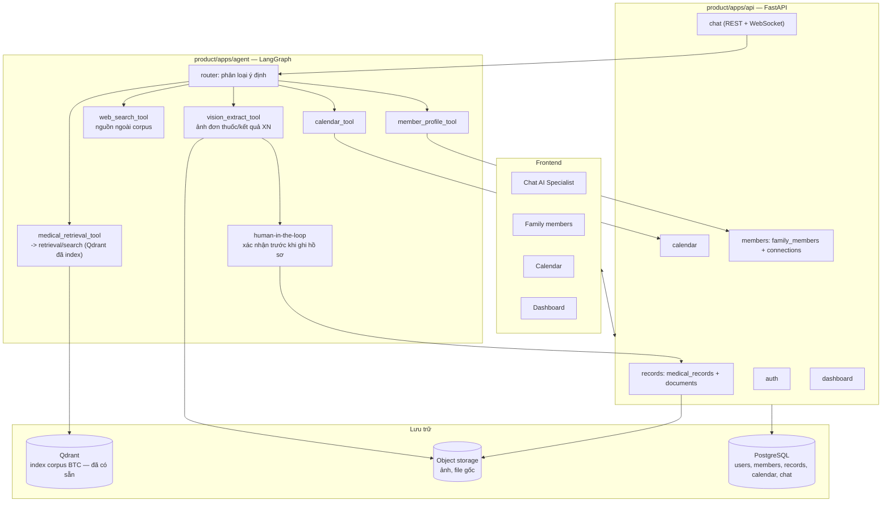

# 04 — Mở rộng thành trợ lý y tế gia đình (Agentic RAG + đa phương thức)

> Giai đoạn mới, sau khi R2AI2026 kết thúc. Mục tiêu: biến `multilingual-medical-retrieval` từ **module truy hồi chấm điểm** thành **lõi tìm kiếm y khoa** của một sản phẩm trợ lý gia đình, theo hướng giao diện tham khảo (medOK): chat AI, hồ sơ thành viên gia đình, lịch, dashboard, hiểu ảnh (đơn thuốc).
>
> Nguyên tắc giữ nguyên từ `01_cau_truc_va_schema.md`: mỗi file một việc, chia theo concern, ưu tiên framework có sẵn, `common/` đổi phải cân nhắc kỹ vì nhiều phía dùng chung.

---

## 1. Việc gì giữ nguyên, việc gì mới

Repo thi đấu (`retrieval/`, `submission/`, `common/`, `corpus_sync/`) **không sửa pipeline lõi** — nó đã build index xong trên corpus BTC, index nằm trong Qdrant. Vai trò của nó trong sản phẩm mới: **một tool nội bộ**, agent gọi vào để tìm tài liệu y khoa, không còn chạy theo luồng "sinh file nộp .zip".

| Thành phần cũ | Vai trò mới |
|---|---|
| `retrieval/search/hybrid.py` (`HybridSearcher`) | Lõi của tool `medical_retrieval_tool` cho agent |
| Qdrant (đã index) | Vector store dùng chung, chỉ đọc (read-only) từ phía sản phẩm |
| `retrieval/run_index.py` | Chỉ chạy lại khi muốn nạp thêm corpus, không chạy trong luồng chat |
| `submission/` | Giữ nguyên, không liên quan sản phẩm mới |

Thành phần **hoàn toàn mới**, nằm trong một thư mục gốc riêng (`product/`) để không trộn với mã của cuộc thi:

- Backend sản phẩm (tài khoản, thành viên gia đình, hồ sơ y tế, lịch, dashboard)
- Agent orchestrator (Agentic RAG, đa công cụ)
- Xử lý đa phương thức (ảnh đơn thuốc, tài liệu)
- Frontend (ngoài phạm vi tài liệu này — chỉ ghi chú hợp đồng API)

---

## 2. Kiến trúc tổng thể



Điểm mấu chốt: **agent không ghi thẳng vào hồ sơ**. Mọi thông tin trích xuất (từ ảnh, từ hội thoại) đi qua bước `CONFIRM` — hiển thị lại cho người dùng duyệt, giống đúng luồng trong ảnh mẫu ("Adding this information to your record..." sau khi người dùng xác nhận). Dữ liệu y tế sai lệch do agent tự ý ghi là rủi ro lớn nhất của sản phẩm này.

---

## 3. Mô hình dữ liệu cốt lõi

Thêm vào `common/schema.py` hiện có (giữ `Doc`, `Chunk`, `Candidate` nguyên vẹn cho phần retrieval), tạo bộ schema sản phẩm riêng trong `product/db/models/`.

| Bảng | Trường chính | Ghi chú |
|---|---|---|
| `users` | id, email, password_hash, display_name | Tài khoản đăng nhập thật |
| `families` | id, owner_user_id, name | Một "hộ gia đình" — namespace chứa member |
| `family_members` | id, family_id, member_type, display_name, dob, linked_user_id (nullable) | Xem mục 4 |
| `connections` | id, requester_user_id, target_user_id, status (pending/accepted/declined) | "Kết bạn thông thường" giữa hai tài khoản thật |
| `medical_records` | id, member_id, kind (condition/medication/allergy/lab_result), payload_json, source_document_id, confirmed_by_user_at | `confirmed_by_user_at` null = agent đề xuất, chưa được duyệt |
| `documents` | id, member_id, storage_path, mime_type, extracted_json, uploaded_at | File gốc (ảnh/PDF) + kết quả OCR/VLM |
| `calendar_events` | id, member_id, type (appointment/medication_reminder/follow_up), starts_at, recurrence_rule, source (manual/agent) | |
| `chat_sessions` / `chat_messages` | id, member_id, role, content, tool_calls_json | Theo từng thành viên, không gộp chung một luồng chat |
| `agent_tool_calls` | id, session_id, tool_name, input, output, created_at | Log bắt buộc — truy vết được agent đã làm gì, cần cho domain y tế |

---

## 4. "Family member" vs "kết bạn thông thường" — tách rõ hai khái niệm

Đây là điểm bạn nhắc tới, cần làm rõ vì chúng khác bản chất:

- **Family member (hồ sơ do chủ tài khoản quản lý):** không nhất thiết có tài khoản đăng nhập riêng — ví dụ con nhỏ, người lớn tuổi không dùng app. Tạo bằng cách điền tên + chọn `member_type` (`self`, `spouse`, `child`, `parent`, `sibling`, `other_relative`). `linked_user_id` = null.
- **Kết bạn thông thường (connection):** hai **tài khoản thật** gửi/nhận lời mời qua `connections`. Sau khi `accepted`, chủ gia đình có thể **gắn** người đó vào `families` của mình như một `family_member` có `linked_user_id` trỏ sang tài khoản thật — lúc này người được gắn tự quản lý hồ sơ của chính họ, chủ gia đình chỉ có quyền xem theo mức được cấp.

Luồng UI gộp hai bước: (1) tìm người theo email/số điện thoại → gửi lời mời kết bạn, hoặc (2) tạo hồ sơ quản lý trực tiếp không cần mời. Cả hai cuối cùng đều hiện trong danh sách "Family members (N)" như ảnh mẫu, chỉ khác `linked_user_id` có hay không.

**Phân quyền xem** (cần bạn quyết định mức độ): tối thiểu nên có 2 mức — `manage` (chủ gia đình, xem/sửa mọi hồ sơ con quản lý) và `view_own` (member có `linked_user_id` chỉ tự sửa hồ sơ của mình, chủ gia đình chỉ xem).

---

## 5. Agentic RAG — nhiều công cụ

### 5.1 Framework điều phối agent

| Lựa chọn | Quyết định | Lý do |
|---|---|---|
| **LangGraph** | **Dùng** | Đã có trong định hướng cũ (`ai-health-assistant.md`), hỗ trợ state machine + human-in-the-loop (`interrupt`) sẵn — khớp đúng yêu cầu "xác nhận trước khi ghi hồ sơ" |
| CrewAI | Không dùng | Thiên về multi-agent cộng tác, bài toán này là một agent + nhiều tool, không cần |
| Tự viết loop gọi tool | Không dùng | LangGraph đã giải quyết retry, state, checkpoint hội thoại — tự viết lại tốn công vô ích |

### 5.2 Router

Node đầu tiên phân loại ý định câu hỏi/tin nhắn: `hỏi_triệu_chứng`, `tải_tài_liệu`, `đặt_lịch`, `hỏi_hồ_sơ_thành_viên`, `khác`. Dựa trên phân loại, graph đi vào nhánh gọi tool tương ứng. Dùng LLM nhỏ (function-calling) để router quyết định tool, không hard-code regex.

### 5.3 Bộ công cụ (tools)

| Tool | Nguồn | Khi nào gọi |
|---|---|---|
| `medical_retrieval_tool` | Gọi `retrieval/search/hybrid.py` qua Qdrant đã index | Câu hỏi y khoa chung, cần đối chiếu tài liệu đáng tin |
| `web_search_tool` | API tìm kiếm ngoài (Tavily/SerpAPI/Bing — xem mục 5.4) | Thông tin không có trong corpus BTC: giá thuốc, tin y tế mới, địa chỉ phòng khám |
| `vision_extract_tool` | VLM/OCR xử lý ảnh | Người dùng gửi ảnh đơn thuốc, kết quả xét nghiệm |
| `calendar_tool` | CRUD `calendar_events` | Đặt/sửa/xoá lịch hẹn, nhắc thuốc |
| `member_profile_tool` | CRUD `family_members`/`medical_records` | Truy vấn hoặc cập nhật hồ sơ |

### 5.4 Framework/dịch vụ cho từng tool

| Việc | Candidate | Quyết định | Lý do |
|---|---|---|---|
| Tìm kiếm web | Tavily | **Đề xuất dùng** | Thiết kế riêng cho agent (trả kết quả đã tóm tắt, ít nhiễu hơn SERP thô) |
| | SerpAPI / Bing Search | Phương án thay thế | Nếu cần kết quả Google thô hoặc giới hạn ngân sách khác |
| | DuckDuckGo (miễn phí, không key) | Dự phòng | Chất lượng thấp hơn, dùng khi chưa có ngân sách |
| OCR/hiểu ảnh đơn thuốc | VLM mở (Qwen-VL, MiniCPM-V) chạy local | Có thể dùng | Nhất quán với máy GPU đã có sẵn cho embed; không tốn phí API |
| | VLM đóng (GPT-4V/Claude/Gemini qua API) | Có thể dùng | Cuộc thi đã kết thúc nên **không còn ràng buộc "chỉ model mở"** — độ chính xác đọc chữ viết tay trên đơn thuốc thường tốt hơn, đáng cân nhắc nếu chấp nhận chi phí API |
| | Tesseract/PaddleOCR thuần OCR | Không ưu tiên | Chỉ đọc chữ, không hiểu ngữ cảnh (không tự phân biệt được đâu là tên thuốc, đâu là liều dùng) — phải tự viết thêm logic trích trường, ngược nguyên tắc ưu tiên có sẵn |
| Lên lịch nhắc | APScheduler | **Đề xuất dùng** | Nhẹ, chạy trong cùng process FastAPI, đủ cho nhắc lịch cá nhân |
| | Celery + Redis | Phương án thay thế | Chỉ cần khi số lượng nhắc lịch lớn, cần hàng đợi phân tán |

### 5.5 Luồng xử lý ảnh (khớp ảnh mẫu)

1. Người dùng gửi ảnh đơn thuốc trong khung chat.
2. Backend lưu file gốc vào `documents` (object storage), trạng thái `processing`.
3. Agent gọi `vision_extract_tool` → model trả JSON có cấu trúc: tên thuốc, liều dùng, bác sĩ kê đơn, ngày, nơi cấp.
4. Agent trả lời bằng ngôn ngữ tự nhiên, liệt kê lại thông tin trích được, **hỏi xác nhận** (đúng như "Please provide me with your documents, and I will add this information to your medical record").
5. Người dùng xác nhận → agent gọi `member_profile_tool` ghi vào `medical_records`, đánh dấu `confirmed_by_user_at`; nếu đơn thuốc có lịch tái khám/uống thuốc định kỳ, đề xuất tạo `calendar_events` tương ứng (vẫn hỏi xác nhận riêng, không tự tạo).
6. `documents.extracted_json` giữ nguyên bản trích xuất gốc để tra lại khi có tranh chấp giữa dữ liệu agent đọc và dữ liệu đã lưu.

---

## 6. Lịch (Calendar)

- Ba loại sự kiện: `appointment` (lịch khám), `medication_reminder` (nhắc uống thuốc, có `recurrence_rule` kiểu RFC 5545), `follow_up` (tái khám).
- Hai nguồn tạo: người dùng tự thêm thủ công, hoặc agent đề xuất từ hội thoại/đơn thuốc (luôn qua bước xác nhận như mục 5.5).
- Thông báo: APScheduler chạy job định kỳ quét `calendar_events` sắp tới, gửi qua kênh đã có (email/push — tuỳ frontend).

---

## 7. Dashboard — đề xuất cụ thể

Vì đây là phần bạn chưa định hình, đây là đề xuất dựa trên dữ liệu đã có trong schema ở mục 3, không bịa thêm chỉ số cần hệ thống ngoài không có:

1. **Tổng quan sử dụng** (giống khung "Total requests / Uploaded documents" trong ảnh, nhưng gắn ý nghĩa y tế rõ hơn): số lượt tư vấn tháng này, số tài liệu y tế đã lưu, số lịch hẹn sắp tới trong 7 ngày.
2. **Thẻ từng thành viên gia đình**: ảnh đại diện, tuổi, số hồ sơ y tế đang có, cảnh báo nổi bật nếu có (dị ứng, bệnh mãn tính được ghi trong `medical_records.kind = allergy|condition`).
3. **Dòng thời gian sự kiện sức khoẻ gần đây**: theo từng thành viên, gộp `documents` mới tải lên + `medical_records` mới xác nhận, sắp theo thời gian.
4. **Lịch sắp tới (rút gọn)**: 3–5 sự kiện gần nhất, trỏ sang trang Calendar đầy đủ.
5. **(P2, chỉ khi có dữ liệu định lượng)**: nếu về sau cho phép nhập số liệu (cân nặng, huyết áp) thì mới thêm biểu đồ xu hướng — tránh dựng biểu đồ "sức khoẻ tổng quát" suy diễn từ văn bản, dễ sai và dễ bị hiểu nhầm là chẩn đoán.

Không đề xuất điểm "sức khoẻ tổng" dạng số (ví dụ "85/100") vì không có cơ sở y khoa để tính, dễ gây hiểu lầm là đánh giá chuyên môn.

---

## 8. Cấu trúc thư mục đề xuất (mới, tách biệt với `retrieval/` của cuộc thi)

```
product/
├─ apps/
│  ├─ api/                      # FastAPI — mỗi domain một router, một thư mục
│  │  ├─ auth/
│  │  ├─ members/                # family_members + connections
│  │  ├─ records/                # medical_records + documents
│  │  ├─ calendar/
│  │  ├─ chat/                   # REST + WebSocket cho hội thoại
│  │  └─ dashboard/
│  ├─ agent/                     # LangGraph orchestrator
│  │  ├─ graph.py                # định nghĩa state machine + router
│  │  ├─ tools/
│  │  │  ├─ medical_retrieval_tool.py   # bọc retrieval/search, KHÔNG sửa code cũ
│  │  │  ├─ web_search_tool.py
│  │  │  ├─ vision_extract_tool.py
│  │  │  ├─ calendar_tool.py
│  │  │  └─ member_profile_tool.py
│  │  └─ prompts/
│  └─ web/                       # frontend — ngoài phạm vi tài liệu này
├─ db/
│  ├─ models/                    # SQLAlchemy, một file một bảng
│  └─ migrations/                # Alembic
└─ tests/
   ├─ api/
   ├─ agent/
   └─ db/
```

`medical_retrieval_tool.py` gọi thẳng `retrieval/search/hybrid.py` (hoặc một hàm `Retriever.retrieve()` nếu bạn muốn bọc thêm một lớp API ổn định) — không copy logic, không sửa repo cũ.

---

## 9. Lộ trình triển khai

| Giai đoạn | Nội dung |
|---|---|
| **P0** | `users`/`families`/`family_members` (member_type) + chat cơ bản gọi `medical_retrieval_tool` trên index đã có |
| **P1** | Tải ảnh lên + `vision_extract_tool` + luồng xác nhận trước khi ghi hồ sơ; calendar thêm thủ công |
| **P2** | Agent tự đề xuất lịch nhắc từ đơn thuốc; `web_search_tool`; dashboard đầy đủ; kết bạn thật (`connections`) + phân quyền xem |

---

## 10. Việc cần bạn quyết định trước khi code

1. **Vision model**: VLM mở chạy local (đồng bộ với máy GPU đã dùng để embed) hay API đóng (độ chính xác cao hơn với chữ viết tay, nhưng tốn phí, cần gửi ảnh ra ngoài — cân nhắc quyền riêng tư dữ liệu y tế)?
2. **Dịch vụ web search**: Tavily / SerpAPI / Bing — ảnh hưởng chi phí và chất lượng nguồn trả về.
3. **Mức phân quyền xem hồ sơ** giữa các family member: chỉ 2 mức (`manage` / `view_own`) có đủ, hay cần mức trung gian (ví dụ vợ/chồng xem được nhau, nhưng con không xem được hồ sơ cha mẹ)?
4. **Nơi chạy agent**: cùng process với FastAPI (đơn giản, đủ cho giai đoạn đầu) hay tách service riêng (cần khi agent cần GPU riêng cho VLM)?

Trả lời 4 câu trên thì mình bắt đầu dựng từng module theo đúng thứ tự P0 → P2, mỗi module liệt kê framework ứng viên trước khi viết code như quy ước.