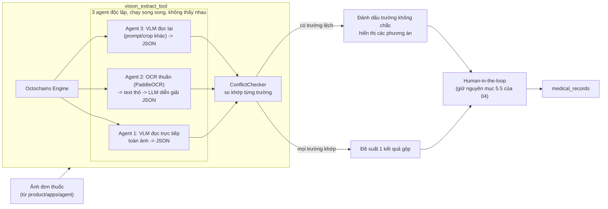

# 05 — Xác minh ảnh y tế bằng Octochains (nhiều agent độc lập, chống đọc sai)

> Bổ sung cho `04_mo_rong_tro_ly_y_te_gia_dinh.md`, cụ thể hoá mục 5.5 (luồng xử lý ảnh). Không thay LangGraph: LangGraph vẫn điều phối toàn bộ hội thoại; Octochains chỉ chạy **bên trong** `vision_extract_tool`, ở bước cần độ tin cậy cao nhất của cả hệ thống — đọc đơn thuốc/kết quả xét nghiệm.

---

## 1. Vì sao cần thêm lớp này

`vision_extract_tool` ở bản thiết kế trước gọi **một lần** VLM rồi đưa thẳng cho người dùng xác nhận. Rủi ro: nếu model đọc sai một trường (ví dụ nhầm "5mg" thành "50mg", hoặc đọc nhầm tên hai loại thuốc viết tay gần giống nhau), người dùng có xu hướng tin và xác nhận nhanh mà không tự đối chiếu lại ảnh gốc — đây là lỗi tự động hoá kinh điển (automation bias), hậu quả trong lĩnh vực y tế có thể nghiêm trọng.

Giải pháp: dùng Octochains để chạy **nhiều cách đọc độc lập, không thấy kết quả của nhau**, rồi so khớp. Chỉ khi các cách đọc đồng thuận mới hiển thị một kết quả gộp; khi lệch nhau thì hiển thị rõ chỗ bất đồng, buộc người dùng tự quyết thay vì hệ thống chọn hộ.

---

## 2. Vị trí trong kiến trúc tổng thể



Điểm mấu chốt: **Octochains không thay thế bước xác nhận của người dùng** (mục 5.5 trong `04_...md`) — nó chỉ làm cho những gì đưa ra trước mặt người dùng đáng tin hơn, và chủ động chỉ ra chỗ hệ thống "không chắc" thay vì im lặng đoán.

---

## 3. Ba agent — vì sao mỗi agent phải khác nguồn lỗi

Nguyên tắc của Octochains chỉ có tác dụng nếu lỗi của các agent **không tương quan với nhau** — ba lần hỏi cùng một VLM với cùng một prompt gần như chắc chắn sai giống nhau cả ba lần.

| Agent | Cách đọc | Nguồn lỗi khác với các agent còn lại |
|---|---|---|
| **Agent 1** | VLM đọc trực tiếp ảnh gốc → trả JSON có cấu trúc (tên thuốc, liều, bác sĩ, ngày, nơi cấp) | Model chính, pipeline mặc định |
| **Agent 2** | OCR thuần (PaddleOCR) tách chữ → đưa text thô cho LLM văn bản (không nhìn ảnh) diễn giải thành cùng JSON | Không phụ thuộc khả năng thị giác của VLM — nếu VLM "ảo giác" ra một từ hợp lý về mặt ngữ nghĩa nhưng không có trên ảnh, OCR thuần không mắc lỗi kiểu này |
| **Agent 3** | VLM đọc lại, nhưng crop ảnh theo từng vùng (tên thuốc riêng, liều dùng riêng) + prompt khác + nhiệt độ khác | Giảm lỗi do model gộp nhầm thông tin giữa các dòng khi đọc nguyên ảnh lớn cùng lúc |

Nếu sau này thêm agent thứ 4, nên chọn tiếp một nguồn lỗi khác hẳn (ví dụ một VLM nhà cung cấp khác) thay vì lặp lại kiểu agent đã có — thêm agent giống nhau không tăng độ tin cậy, chỉ tăng chi phí.

---

## 4. ConflictChecker — so khớp theo từng trường, không so cả khối JSON

So sánh nguyên văn JSON sẽ luôn "xung đột" (khác cách viết hoa, dấu cách...). Cần so khớp theo **từng trường có ý nghĩa**:

| Trường | Cách so khớp |
|---|---|
| Tên thuốc | Chuẩn hoá (lowercase, bỏ dấu câu) rồi so khớp gần đúng (ví dụ `rapidfuzz`), ngưỡng tương đồng cao vì sai một ký tự trong tên thuốc là sai nghiêm trọng |
| Liều dùng (số + đơn vị) | So khớp **chính xác** sau khi chuẩn hoá đơn vị (`5mg` = `5 mg`) — đây là trường nhạy cảm nhất, không chấp nhận "gần đúng" |
| Ngày tháng | Chuẩn hoá về một định dạng rồi so khớp chính xác |
| Bác sĩ/nơi cấp | So khớp gần đúng, ít nghiêm trọng hơn nếu lệch nhẹ |

Kết quả `ConflictChecker` trả về theo từng trường: `agree` (3/3 hoặc tối thiểu 2/3 khớp) hoặc `disagree` (kèm cả 2–3 giá trị khác nhau để hiển thị). Trường `disagree` **không được tự động chọn giá trị đa số** cho liều dùng và tên thuốc — phải bắt buộc người dùng chọn hoặc tự nhập, vì đây là hai trường hậu quả sai cao nhất.

---

## 5. Thư viện

| Việc | Candidate | Quyết định | Lý do |
|---|---|---|---|
| Điều phối nhiều agent song song + gộp | **Octochains** | Dùng | Đúng mục đích: cô lập agent, không lan truyền lỗi, có sẵn `ConflictChecker` |
| OCR thuần cho Agent 2 | PaddleOCR | Đề xuất dùng | Hỗ trợ tiếng Việt tốt, mã nguồn mở, không cần gọi API ngoài |
| | Tesseract | Dự phòng | Yếu hơn với chữ viết tay/tiếng Việt có dấu |
| So khớp chuỗi gần đúng | `rapidfuzz` | Dùng | Nhẹ, nhanh, đủ cho so khớp tên thuốc/bác sĩ |
| VLM cho Agent 1 & 3 | Giống lựa chọn ở mục 5.5 của `04_...md` (VLM mở hoặc đóng) | Chưa chốt | Phụ thuộc câu hỏi 1 trong mục 10 của `04_...md` |

Lưu ý giấy phép: Octochains dùng **Business Source License 1.1**, không phải MIT/Apache — cần đọc kỹ điều khoản trước khi dùng trong sản phẩm thương mại (BSL thường giới hạn việc bán lại chính package đó, không cấm dùng nội bộ, nhưng cần xác nhận lại điều khoản bản hiện hành trước khi triển khai).

---

## 6. Cấu trúc file (khớp `product/apps/agent/tools/` trong `04_...md`)

```
product/apps/agent/tools/vision_extract_tool/
├─ __init__.py              # expose hàm extract(image) cho LangGraph gọi vào
├─ agents/
│  ├─ vlm_direct.py         # Agent 1
│  ├─ ocr_then_llm.py       # Agent 2
│  └─ vlm_cropped.py        # Agent 3
├─ aggregate/
│  ├─ field_match.py        # chuẩn hoá + so khớp từng trường
│  └─ conflict_checker.py   # bọc Octochains ConflictChecker, trả kết quả theo mục 4
└─ schema.py                # JSON schema chung cho cả 3 agent (bắt buộc cùng khuôn dạng)
```

`schema.py` quan trọng nhất: cả ba agent phải trả về **đúng cùng một cấu trúc trường**, nếu không `field_match.py` không so khớp được. Nên định nghĩa bằng Pydantic, dùng chung một model cho cả ba prompt.

---

## 7. Giới hạn cần biết trước khi dùng

- **Chi phí và độ trễ tăng gấp 2–3 lần** so với gọi VLM một lần (chạy 3 agent, dù song song vẫn tốn 3 lần quota API nếu dùng VLM đóng). Chỉ bật multi-agent cho **ảnh y tế quan trọng** (đơn thuốc, kết quả xét nghiệm) — không cần cho các câu hỏi chat thông thường hay ảnh không quyết định hành động y tế.
- Octochains cô lập agent để chống **thiên lệch đồng thuận giả** (một agent thấy kết quả agent khác rồi bị ảnh hưởng) — nhưng không tự động đúng hơn một agent đơn lẻ nếu tất cả agent cùng dùng một nguồn ảnh bị mờ/thiếu sáng. Multi-agent giảm lỗi do model, không sửa được lỗi do ảnh chụp kém — vẫn cần kiểm tra chất lượng ảnh (độ nét, đủ sáng) trước khi đưa vào xử lý.
- Đây là lớp bổ sung cho độ tin cậy, **không thay thế bước xác nhận cuối của người dùng**.

---

## 8. Việc cần bạn quyết định

1. **Số lượng agent**: 3 như đề xuất, hay 2 là đủ để giảm chi phí (bỏ Agent 3, chỉ giữ VLM-trực-tiếp + OCR-thuần)?
2. **Ngưỡng coi là "mâu thuẫn"**: với tên thuốc, độ tương đồng bao nhiêu % thì coi là khớp (ví dụ ≥ 90%)? Cần thử trên vài chục ảnh mẫu thật trước khi chốt số.
3. **VLM nào cho Agent 1 và Agent 3** — chốt cùng lúc với câu hỏi 1 ở mục 10 của `04_...md` (mở hay đóng), vì ảnh hưởng chi phí chạy 2 lần VLM cho một ảnh.